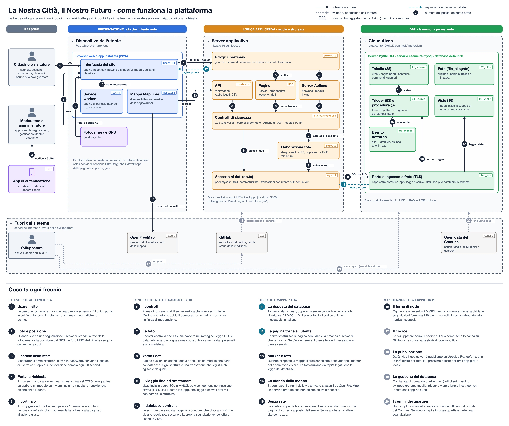

# Architettura

Il disegno mostra tutti i pezzi della piattaforma e il percorso di una richiesta, da chi usa il sito
fino al database. Lo trova in due formati:

| File | Cosa contiene |
|---|---|
| [architettura.jpg](architettura.jpg) | L'immagine da stampare o allegare, con la spiegazione di ogni freccia in fondo |
| [architettura.svg](architettura.svg) | Lo stesso disegno in vettoriale, si ingrandisce senza perdere qualità |
| [architettura.html](architettura.html) | La versione interattiva: va scaricata e aperta nel browser, funziona anche senza rete |

## Come si legge

Le fasce colorate in alto sono i livelli logici: le persone, la presentazione (ciò che l'utente vede),
la logica applicativa (regole e sicurezza) e i dati. I riquadri tratteggiati sono i luoghi fisici
dove gira ogni pezzo: il telefono o il PC dell'utente, il server con Next.js, il cloud di Aiven ad
Amsterdam e, in basso, i servizi esterni con il lavoro dello sviluppatore.

Le frecce hanno tre stili:

- la linea continua è una richiesta o un'azione;
- il tratteggio è una risposta, cioè i dati che tornano indietro;
- i puntini grigi indicano lo sviluppo o un'operazione fatta una volta sola.

Ho numerato le frecce nell'ordine in cui le attraversa una richiesta. Dalla 1 alla 12 segui, per
esempio, un cittadino che invia una segnalazione: il browser manda il modulo, il server controlla
permessi e foto, il database applica le sue regole e la pagina torna all'utente. Le frecce dalla 13
alla 20 coprono la mappa, la pagina offline, la manutenzione notturna e il lavoro dello sviluppatore.

## La versione interattiva

Nel file HTML si trascina il disegno per spostarsi e si usa la rotellina per lo zoom. Un clic su una
freccia o su un componente apre la spiegazione nel pannello a destra e mette in evidenza i
collegamenti. Si possono anche chiudere i riquadri dal titolo, nascondere le frecce che non
interessano, seguire il percorso guidato passo per passo (anche con le frecce ← → della tastiera) e
disegnare sopra con la matita.

La pubblicazione su Vercel, la freccia 18, non l'ho ancora fatta: per ora la web app gira sul mio
computer.
