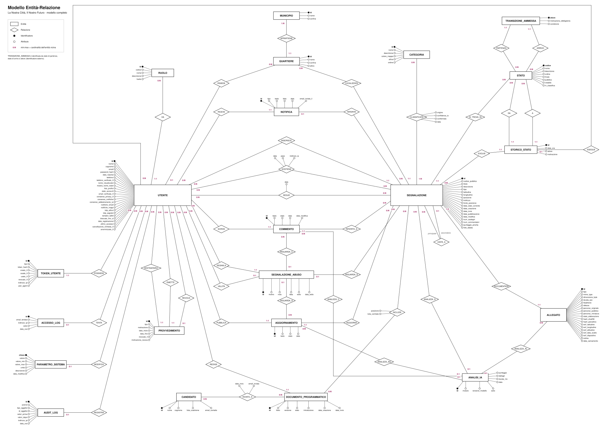

# Modello Entità-Relazione



Ho disegnato il modello in notazione di Chen, la stessa usata a lezione:

- il rettangolo è un'entità, il rombo una relazione;
- il pallino pieno indica l'identificatore, quello vuoto un attributo;
- accanto a ogni entità, sulla linea che la collega a una relazione, c'è la cardinalità min:max
  con cui l'entità partecipa. Per esempio UTENTE (0:N) INSERISCE (1:1) SEGNALAZIONE si legge così:
  un utente inserisce da zero a molte segnalazioni, ogni segnalazione ha esattamente un autore.

Il modello ha 22 entità e 42 relazioni. Le associazioni molti a molti che nel database diventano
tabelle (SOSTIENE, SEGUE, CLASSIFICATA, INCLUDE, INVIATO_A) qui compaiono come relazioni, con i loro
attributi attaccati al rombo. UNITA_A è una relazione ricorsiva su SEGNALAZIONE: una segnalazione
duplicata ("secondaria") confluisce in una "principale".

Gli attributi sono quelli delle tabelle in [`db/01_schema.sql`](../../db/01_schema.sql), senza le
chiavi esterne, che nel modello concettuale sono rappresentate dalle relazioni.

## Rigenerare il disegno

Il file SVG lo produce uno script Python, senza librerie esterne. Le posizioni di entità e relazioni
sono scritte a mano nello script: per spostare un elemento si cambia la coordinata e si rilancia.

```bash
python3 docs/er/genera_er.py
```
